# MGI-App – Anleitung für Mitglieder

Die Vereins-App der **Modellbau-Gemeinschaft Ismaning e.V.**: Flugbuch, Fotos für die Homepage, Arbeitsdienst, Wetter, Notfall-Infos und mehr – alles auf dem Handy.

**App öffnen:** https://joachimrodler-afk.github.io/MGI-App/

> Die Bilder in dieser Anleitung stammen aus dem Demo-Modus der App und zeigen Beispieldaten.

---

## Inhalt

1. [Installieren](#1-installieren)
2. [Anmelden](#2-anmelden)
3. [Die Startseite](#3-die-startseite)
4. [Flugbuch](#4-flugbuch)
5. [Fotos für die Homepage](#5-fotos-für-die-homepage)
6. [Arbeitsdienst](#6-arbeitsdienst)
7. [Notfall & Platzordnung](#7-notfall--platzordnung)
8. [Technik am Platz](#8-technik-am-platz)
9. [Regel-Assistent (KI)](#9-regel-assistent-ki)
10. [Weitere Funktionen](#10-weitere-funktionen)
11. [Mein Konto & Push-Nachrichten](#11-mein-konto--push-nachrichten)
12. [Hilfe bei Problemen](#12-hilfe-bei-problemen)

---

## 1. Installieren

Öffne den Link zur App (siehe oben oder aus der Einladung des Vorstands) und lege sie auf den Startbildschirm:

| Handy | So geht's |
|---|---|
| **Android** (Chrome) | Menü **⋮** → **„App installieren“** |
| **iPhone** (Safari) | Teilen-Symbol **⬆︎** → **„Zum Home-Bildschirm“** |

Danach startet die App wie eine normale App über ihr Symbol. Auf dem iPhone bitte **immer über das Symbol** öffnen, nicht in Safari – sonst funktionieren Anmeldung und Push-Nachrichten nicht dauerhaft.

---

## 2. Anmelden

1. Oben auf das **Schloss** tippen.
2. **Vor- und Nachname** und deinen **persönlichen PIN** eingeben.
3. **Anmelden** tippen.

Das ist nur **einmal** nötig – danach bleibst du auf diesem Handy angemeldet.

**Noch kein Zugang?** Auf **„Zugang anfragen“** tippen und deinen Namen eingeben. Der Vorstand gibt dich frei und schickt dir deinen PIN.

**PIN vergessen?** Beim Vorstand melden – er vergibt einen neuen.

**Tipp:** Ändere deinen PIN nach der ersten Anmeldung unter **Konto → PIN ändern**.

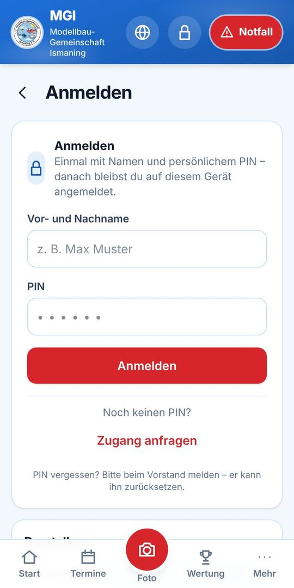

---

## 3. Die Startseite

**Kopfzeile (immer sichtbar):**

| Symbol | Bedeutung |
|---|---|
| 🌐 Globus | Vereins-Homepage www.mgi-ismaning.de |
| 👤 Person / 🔒 Schloss | Mein Konto bzw. Anmelden |
| 🚨 **Notfall** | Notruf, Standort, Platzordnung |

**Auf der Startseite:**
- **Wind & Anwesenheit** – aktueller Wind und wie viele Piloten am Platz sind
- **Gelber Hinweis** – wenn dein Arbeitsdienst bald ansteht
- **Flugbuch** (rote Karte) – mit einem Tipp anmelden
- **Nächste Termine** – die nächsten 3 Termine aus dem Vereinskalender
- **Kacheln** für alle weiteren Bereiche, darunter der **Regel-Assistent (KI)**

**Leiste unten:** Start · Termine · **Foto** (roter Knopf) · Wertung · Mehr

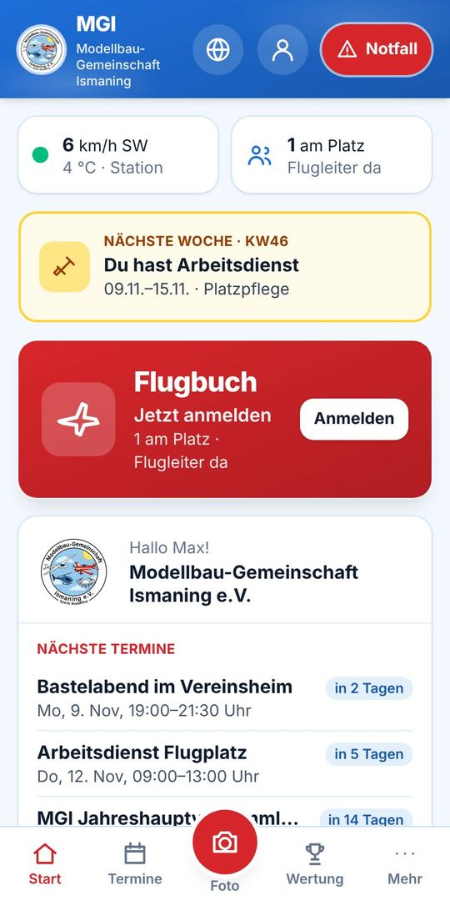

---

## 4. Flugbuch

Das Flugbuch ersetzt den Papiervordruck. **Jeder Pilot meldet sich beim Ankommen an und beim Gehen ab.**

### Anmelden

1. Auf der Startseite die rote Karte **Flugbuch** antippen.
2. **Schulungsnachweis** einschalten, falls vorhanden.
3. **Antriebsart** wählen (auch mehrere möglich).
4. **Gewichtsklasse** wählen.
5. Die **Betriebsregeln bestätigen** (Häkchen).
6. **„Im Flugbuch anmelden“** tippen – Datum und Uhrzeit trägt die App selbst ein.

**Flugleitung übernehmen:** Schalter **„Ich übernehme die Flugleitung“** einschalten und Fangnetz, Rasen, Wetter und Wind angeben (der Wind wird aus dem aktuellen Wetter vorgeschlagen).

**Gäste:** Oben auf **„Gast eintragen“** wechseln, Vor- und Nachname des Gastes eingeben – Rest wie oben.

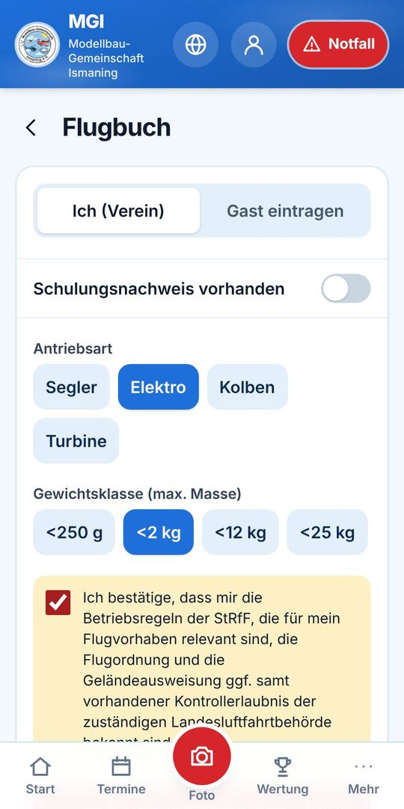

### Während du am Platz bist

- Oben steht grün **„Seit … Uhr im Flugbuch angemeldet“**.
- **Besondere Vorkommnisse:** Hier kannst du frei eintragen, was passiert ist – z. B. Absturz, Beinahe-Zusammenstoß, Schaden am Platz, Störung. **Speichern** tippen. Was beim Abmelden noch nicht gespeichert war, wird automatisch übernommen.
- Darunter: wer heute die **Flugleitung** hat und wer gerade **am Platz** ist.

### Abmelden

**„Abmelden · Ende … Uhr“** tippen, wenn du gehst.
Vergessen? Um **23:59 Uhr** meldet dich die App automatisch ab.

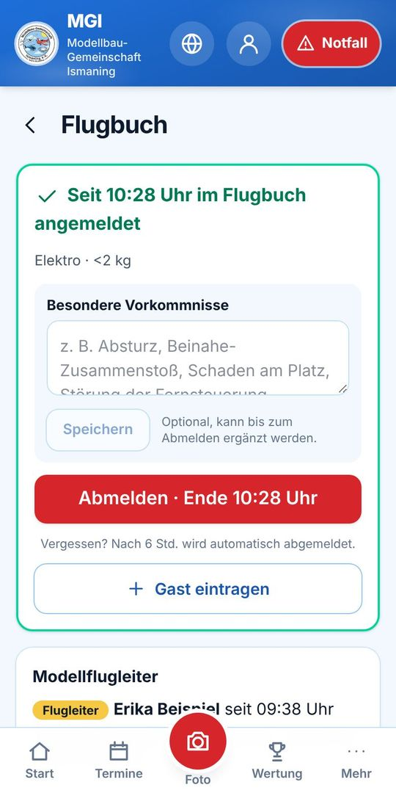

---

## 5. Fotos für die Homepage

1. Unten auf den **roten Kamera-Knopf** tippen.
2. **„Foto aufnehmen“** oder **„Aus Galerie“** wählen (mehrere Bilder möglich).
3. **Kategorie** wählen: Flugtag, Wettbewerb, Schiffsmodell, Arbeitsdienst, Sonstiges.
4. Optional einen **Titel** eingeben, z. B. „Erstflug Segler“.
5. **Hochladen** tippen.

Die Fotos erscheinen automatisch in der **Bildergalerie auf der Homepage** (Seite „Bilder“). Der Dateiname enthält Datum, Uhrzeit, Titel und deinen Namen, z. B. `2026-11-07_10-15_Erstflug-Segler_Max-M.jpg`.

**Ohne Netz** werden die Fotos gespeichert und später automatisch gesendet.

⚠️ Bitte nur Fotos hochladen, mit denen **alle abgebildeten Personen einverstanden** sind.

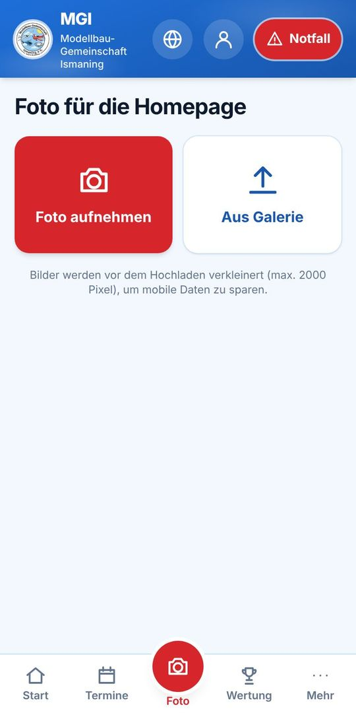

---

## 6. Arbeitsdienst

Die Kachel **Arbeitsdienst** zeigt alle Wochen der Arbeitsliste (April bis Oktober) mit den Einsätzen – Platzpflege, Walzen, Düngen … – und den freien Plätzen.

**Eintragen:**
1. Bei einem freien Platz auf **„Mich eintragen“** tippen.
2. Mit **„Ja, eintragen“** bestätigen.

⚠️ Das Eintragen ist **verbindlich**. Austragen kann nur der Vorstand.

**Die App erinnert dich:**
- auf der Startseite ab zwei Wochen vorher (gelber Hinweis),
- per Push-Nachricht eine Woche vorher und am Montag deiner Woche.

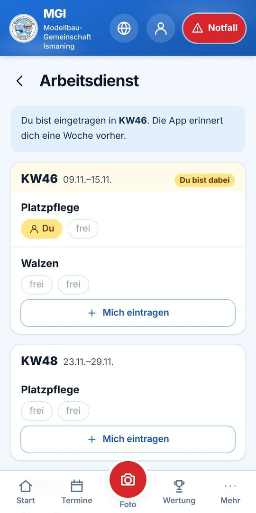

---

## 7. Notfall & Platzordnung

Der rote **Notfall**-Knopf oben ist auf jeder Seite erreichbar und funktioniert **auch ohne Netz**.

**Reiter „Notfall“:**
- **Notruf 112** – direkt anrufen
- **Koordinaten** zum Vorlesen für den Rettungsdienst, zum Kopieren oder für die Navigation
- **Anfahrt** über B388 oder Moosstraße (mit Karte)
- **Erste-Hilfe-Kasten:** außen am Gartenhaus
- **Feuerlöscher:** im Gartenhaus

**Reiter „Platzordnung“:** die wichtigsten Punkte der Flugbetriebsordnung kompakt, mit Bild des **zulässigen Flugraums**.

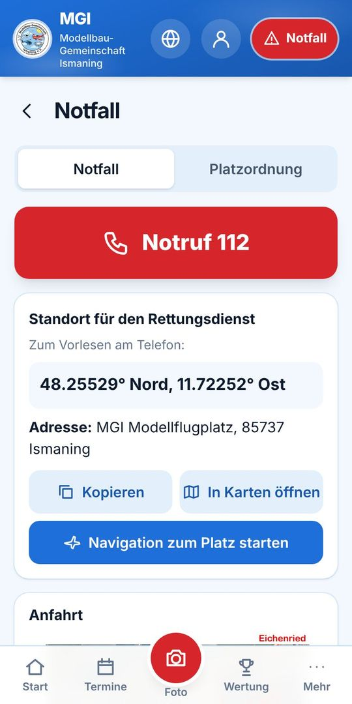

---

## 8. Technik am Platz

Infos zur Ausstattung am Platz:

- **Wetterstation** – mit Blockschaltbild
- **Stromversorgung** – Bluetti mit Solar, Blockschaltbild
- **Walze** – Bedienung
- **Dixi-Toilette** – Zahlenkombination (nur für angemeldete Mitglieder sichtbar)
- **Ladesteckdosen** – je Tisch eine Sicherung 15 A, Tabelle mit dem maximalen Ladestrom je Akku (3S bis 8S)

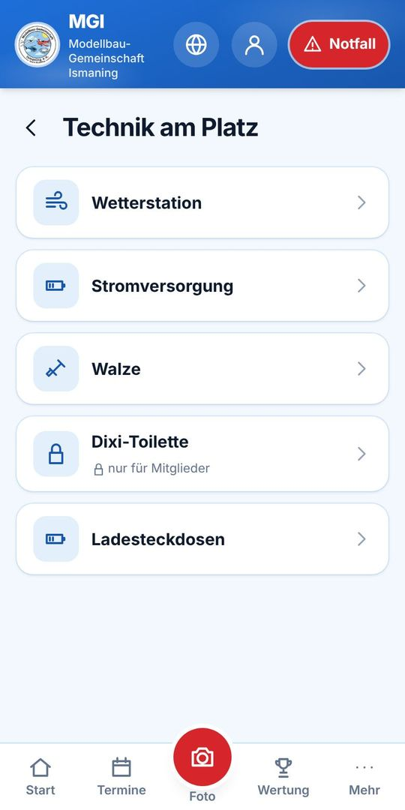

---

## 9. Regel-Assistent (KI)

Fragen zur **Vereinssatzung** und zur **Flugbetriebsordnung** stellst du am einfachsten dem Regel-Assistenten – auf der Startseite oder unter **Mehr → Regel-Assistent (KI)**.

1. Eine Beispielfrage antippen oder selbst eine Frage eintippen, z. B. „Wann muss ein Flugleiter anwesend sein?“
2. Nach ein paar Sekunden kommt die Antwort – mit **Fundstelle**, z. B. „(Flugbetriebsordnung 6.2)“.
3. Nachfragen sind möglich; **Neues Gespräch** fängt von vorne an.

- Die Antworten kommen von einer KI (Google Gemini) und **nur** aus Satzung und Flugbetriebsordnung. Steht etwas nicht drin, verweist sie an den Vorstand.
- **Ohne Gewähr:** Maßgeblich ist immer der Originaltext, im Zweifel entscheidet der Vorstand.
- Nur für angemeldete Mitglieder, bis zu 30 Fragen pro Tag. Dein Name wird nicht an Google übermittelt.

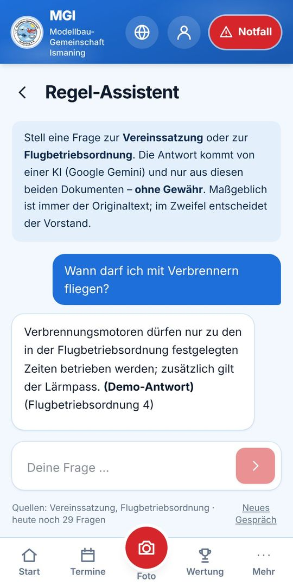

---

## 10. Weitere Funktionen

Alles weitere findest du unten unter **Mehr**:

| Bereich | Was du dort findest |
|---|---|
| 🌬️ **Wetter** | Wind und Böen von der Vereins-Wetterstation, Vorhersage. Die **Ampel** zeigt, ob der Wind zum Fliegen passt. |
| 📹 **Webcam** | Öffnet das Live-Video vom Platz. |
| 🔋 **Strom** | Akkustand und Solarleistung der Bluetti. |
| 📅 **Termine** | Alle Vereinstermine. |
| 🏆 **Wertung** | Ranglisten der Wettbewerbe – aktualisieren sich live. |
| 📌 **Schwarzes Brett** | Biete · Suche · Info. Eigene Beiträge kannst du bearbeiten und löschen. |
| 🪪 **Meine Nachweise** | Ablaufdaten von Kenntnisnachweis, e-ID und Versicherung eintragen – die App erinnert dich 30 und 7 Tage vor Ablauf. |

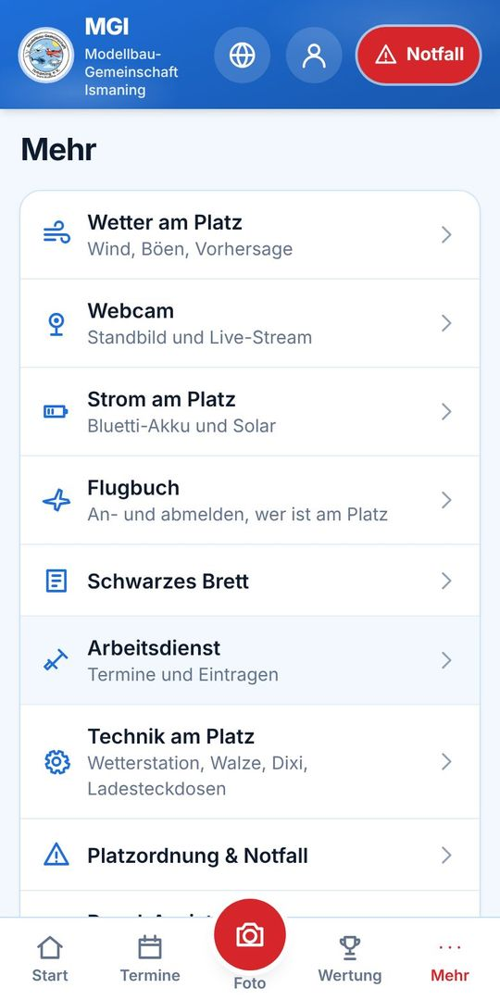

---

## 11. Mein Konto & Push-Nachrichten

Oben auf das **Personen-Symbol** tippen.

**Push-Nachrichten:** Neben der Überschrift steht **an** oder **aus**.
1. Steht dort „aus“: **Push einschalten** tippen und in der Abfrage **Erlauben** wählen.
2. Mit **Test-Nachricht senden** prüfen, ob die Nachrichten ankommen.
3. Dann selbst auswählen, worüber du informiert werden willst:
- Wichtige Mitteilungen (z. B. Platzsperrung)
- Termine
- Wettbewerbsergebnisse
- Schwarzes Brett
- Nachweis-Erinnerungen
- Arbeitsdienst

Auf dem iPhone funktionieren Push-Nachrichten nur in der **installierten** App (iOS 16.4 oder neuer) – Schritt für Schritt: [Kurzanleitung iPhone (PDF)](MGI-App_iPhone.pdf).

**Außerdem:** PIN ändern, Abmelden, Darstellung (Hell / Dunkel / Automatisch).

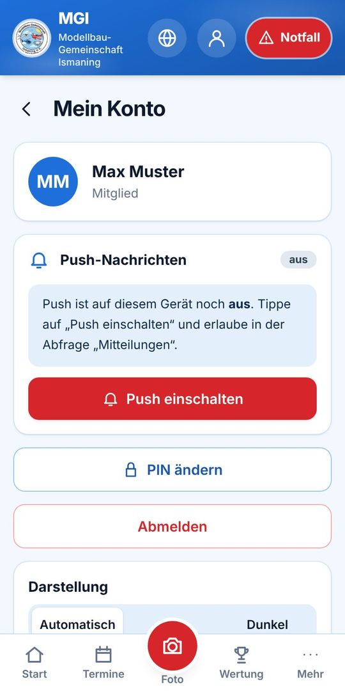

---

## 12. Hilfe bei Problemen

| Problem | Lösung |
|---|---|
| Neue Funktion fehlt / alte Ansicht | Die App aktualisiert sich normalerweise selbst. Sonst **ganz schließen und neu öffnen** (iPhone: von unten wischen, App nach oben wegschieben). Die Version steht unten auf der Seite **Mehr**. |
| Gelber Balken „Offline“ | Kein Netz. Angezeigt wird der letzte bekannte Stand; Fotos werden später gesendet. |
| Keine Push-Nachrichten | Unter **Konto** prüfen, ob „an“ steht, dann **Test-Nachricht senden**. iPhone: App über das Symbol auf dem Home-Bildschirm öffnen; abgelehnt? Einstellungen → Mitteilungen → MGI. |
| PIN vergessen | Beim Vorstand melden. |
| Falsch im Arbeitsdienst eingetragen | Beim Vorstand melden – nur Admins können austragen. |

**Fragen oder Ideen zur App?** Einfach beim Vorstand melden.
